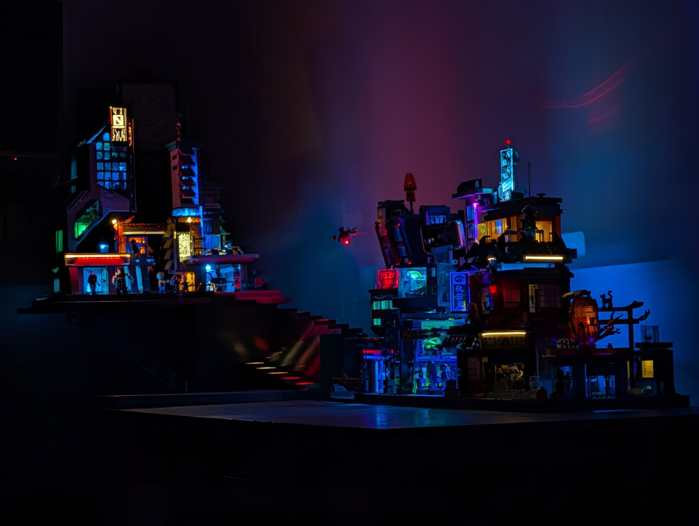
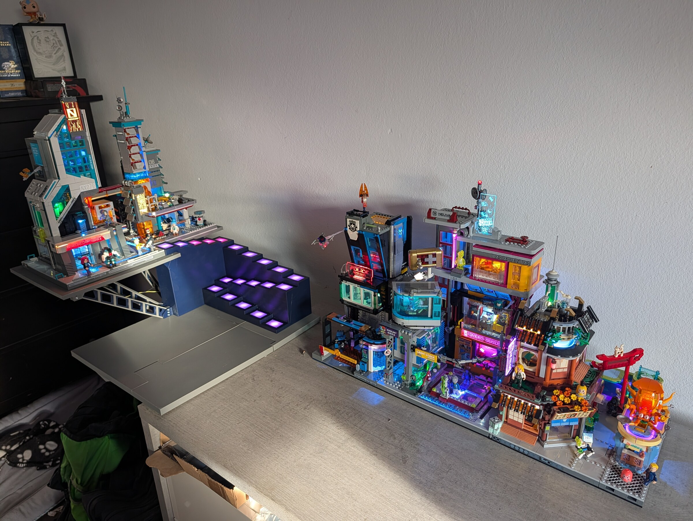
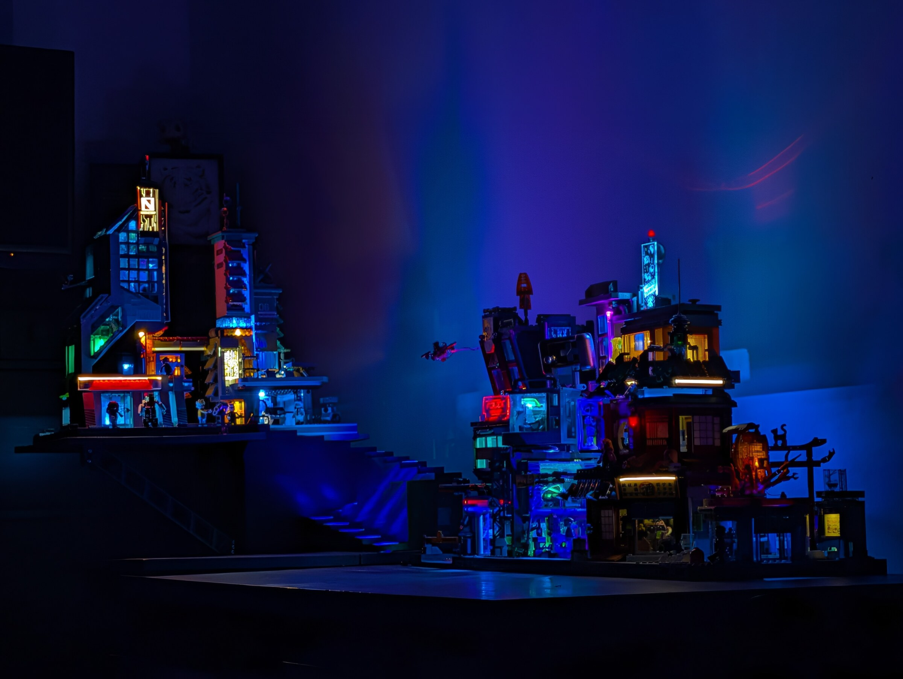

# Cyberpunk Elevated District



A large, modular, 3D-printed support structure for illuminated cyberpunk brick
buildings. The project turns a flat display into a two-level district with
exposed structural trusses, a table-mounted cantilever, two illuminated stair
modules and an integrated 5 V controller/distribution box.

Designed and built by **Matthias Fulz**. Current design release: **v1.0.0**.

> This is an independent fan-made display project. It is not an official
> Lumibricks product and is not affiliated with or endorsed by Lumibricks.
> No commercial building set is included in this repository.

## The finished build

<table>
  <tr>
    <td></td>
    <td></td>
  </tr>
  <tr>
    <td align="center"><em>Scale, overhang and both city levels in daylight</em></td>
    <td align="center"><em>The same district with building and stair lighting active</em></td>
  </tr>
</table>

The staircase is deliberately secondary to the commercial buildings: twenty
individually addressable pixels create a slow, diffused colour runner without
turning the support structure into the visual focus. The trusses, exposed custom
power leads and cantilever are part of the city aesthetic rather than hidden
mounting hardware.

[Watch the 22-second staircase animation](images/video/stair-animation.mp4).
The complete photo set and construction sequence are indexed in
[`images/README.md`](images/README.md).

## What is included

- complete positioned FreeCAD assembly
- 23 unique print-ready parts as STEP and STL
- authoritative quantities and orientations in `models/print/parts.csv`
- source and prebuilt UF2 firmware for 20 addressable stair LEDs
- electronics enclosure for a 70 x 90 mm perfboard controller/distributor
- bill of materials, print notes, wiring and assembly documentation
- final photographs, construction images and an animation video
- reproducible export, firmware-build and release-verification tools

The repeated truss and lighting parts are deduplicated. Print quantities are
stored in the CSV rather than encoded as duplicate files.

## Main characteristics

- target printer envelope: **350 x 350 mm** or larger
- two structural display levels
- 15-step main stair plus 5-step upper stair
- 20 individually addressable 5 V NeoPixels with printed diffusers
- WeAct BlackPill `STM32F401CCU6` controller
- five fixed-5-V building outputs on a star distributor
- M3 screws and heat-set inserts for serviceable structural joints
- flat supports rather than building-specific permanent locks, so the city can
  be rearranged

This is a genuinely large print project. Some individual parts consume most of
a 1 kg spool and run for many hours even on a fast enclosed machine.

## Repository map

| Path | Contents |
|---|---|
| [`models/print/`](models/print/) | Ready-to-slice STEP/STL files and quantities |
| [`models/source/`](models/source/) | Complete FreeCAD assembly and correction-part sources |
| [`firmware/neopixel-stair-20/`](firmware/neopixel-stair-20/) | Arduino source, reproducible build and prebuilt UF2 |
| [`BOM.md`](BOM.md) | Human-readable bill of materials |
| [`CHANGELOG.md`](CHANGELOG.md) | Released design versions |
| [`PRINTING.md`](PRINTING.md) | Print strategy and tested reference settings |
| [`ASSEMBLY.md`](ASSEMBLY.md) | Recommended mechanical assembly sequence |
| [`ELECTRONICS.md`](ELECTRONICS.md) | Wiring, power distribution and measured consumption |
| [`images/`](images/) | Final gallery, build sequence and animation |
| [`tools/`](tools/) | CAD export, UF2 conversion, checksums and release verification |

## Quick start

1. Read [`PRINTING.md`](PRINTING.md) before slicing the large structural parts.
2. Use [`models/print/parts.csv`](models/print/parts.csv) as the authoritative
   quantity list.
3. Dry-fit every structural joint before installing all inserts or applying
   adhesive.
4. Build and test the 20-pixel chain before closing either staircase module.
5. Follow [`ASSEMBLY.md`](ASSEMBLY.md) and use the FreeCAD document as the
   authoritative spatial reference.
6. Feed the electronics box with **regulated 5 V only**. Read
   [`ELECTRONICS.md`](ELECTRONICS.md); its USB-C connectors are power-only and
   are not general-purpose USB-C/PD ports.

## Verified electrical reference

The photographed five-building configuration plus controller and animated
staircase measured approximately **1.75 A at 5 V** (`8.75 W`):

- 20 stair NeoPixels: approximately `0.30 A`
- Tech Tower: approximately `0.50 A`
- original other three buildings plus the continuously powered BlackPill:
  approximately `0.75 A`
- subsequently added Tech Station: approximately `0.20 A` incremental load

These are measurements of one real build, not guaranteed specifications for
other sets. Measure again whenever the district grows.

## Rebuilding generated assets

Export the print files from the positioned FreeCAD document:

```bash
FreeCADCmd tools/export_print_models.py
```

Build and validate the firmware:

```bash
./firmware/neopixel-stair-20/build.sh
```

Validate the packaged release without rebuilding CAD or firmware:

```bash
python3 tools/verify_release.py
```

After an intentional release-file change, regenerate the root checksum manifest:

```bash
python3 tools/update_checksums.py
```

## License

- CAD, STEP, STL, documentation and publication media: **CC BY-NC-SA 4.0**
- firmware and software tools: **MIT**

See [`LICENSE.md`](LICENSE.md) for the exact file mapping and attribution terms.
